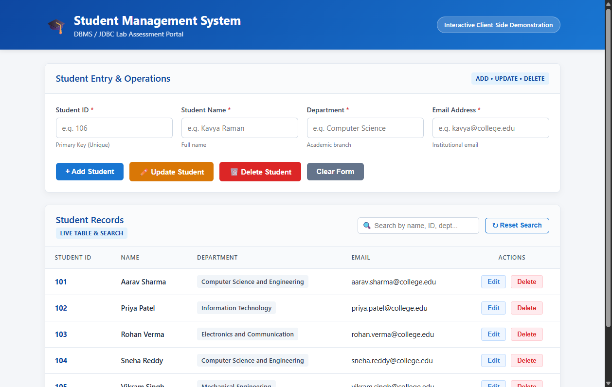
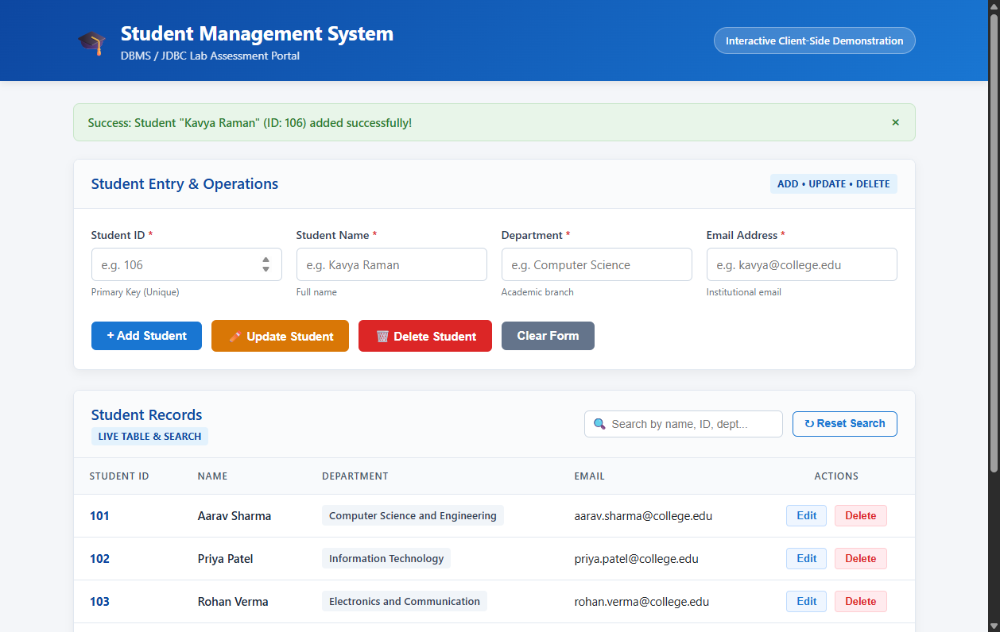
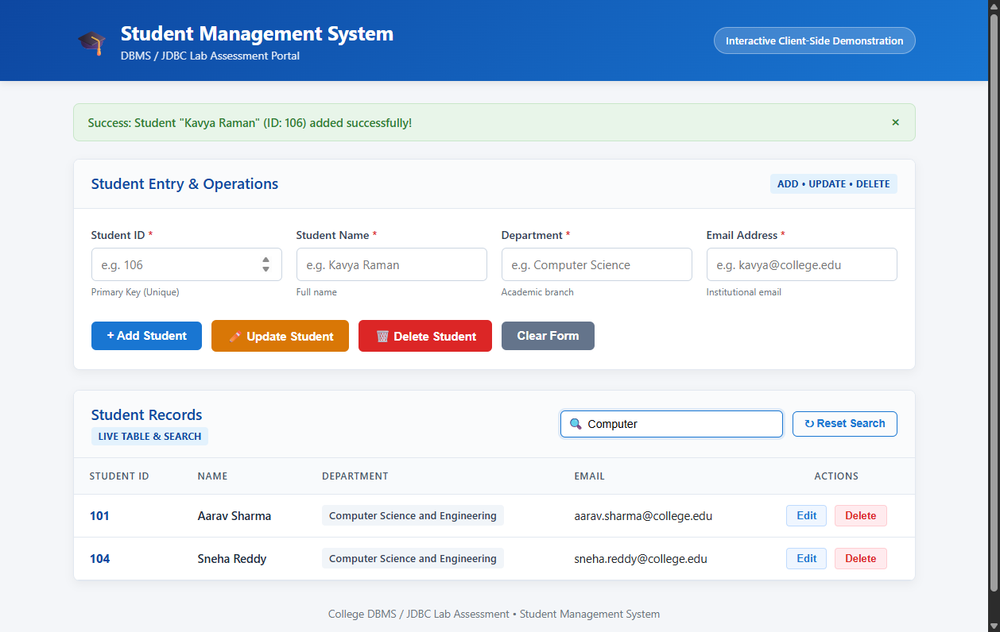
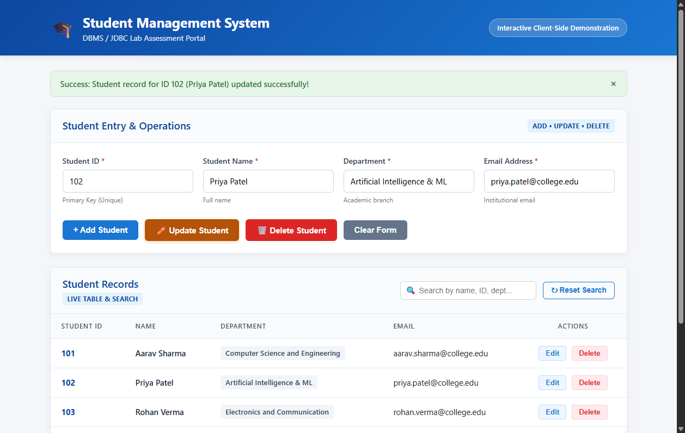
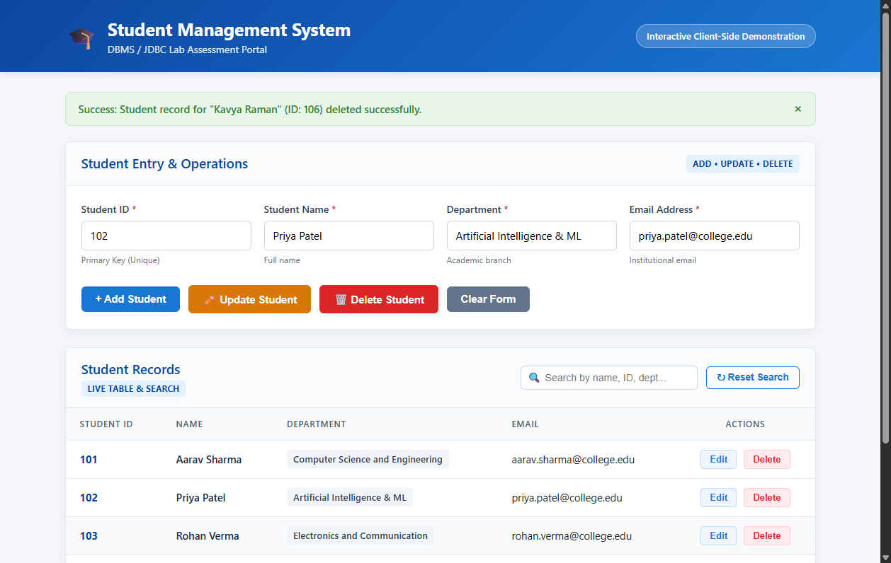
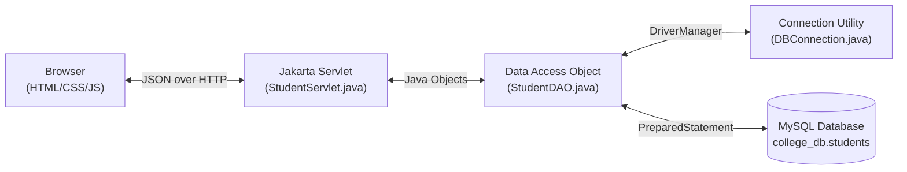

# Student Management System

[](#)
[](#)
[](#)
[](#)
[](#)
[](#)

> **Course:** Database Management Systems &amp; Advanced Java Programming  
> **Prepared for:** **Lab Assessment 5**  
> **Student / Author:** praveengowtm  
> **Repository:** [https://github.com/praveengowtm/Student-Management-System-](https://github.com/praveengowtm/Student-Management-System-)

---

## 📌 Project Overview

The **Student Management System** is a full-stack academic web application developed for **College DBMS / JDBC Lab Assessment 5**. It demonstrates fundamental software engineering and database principles:
1. **Frontend Development:** Responsive, modern user interface built using HTML5, CSS3, and vanilla JavaScript (no external CSS/JS frameworks).
2. **Backend Development:** RESTful HTTP Servlet architecture implemented using **Jakarta Servlet API** running on **Apache Tomcat 10.1**.
3. **Database Connectivity (JDBC):** Pure Java Database Connectivity with parameterized `PreparedStatement` to prevent SQL Injection attacks.
4. **Relational Database Management:** Relational schema design and data persistence using **MySQL**.
5. **Complete CRUD Operations:** Create, Read, Update, Delete, and real-time Search filtering.

---

## 🚀 Key Features

- **Add Student (Create):** Validates user input (ID, Name, Department, Email), detects duplicate primary keys, and inserts records into the database.
- **View Records (Read):** Dynamically displays all student records in a structured table on page load.
- **Update Student (Update):** Selects an existing student from the table, populates the form, locks the Student ID (immutable Primary Key), and updates Name, Department, and Email.
- **Delete Student (Delete):** Deletes records by Student ID with a mandatory user confirmation dialog (`window.confirm`).
- **Live Search & Filter:** Instant real-time filtering across Student ID, Name, Department, and Email fields.
- **Clean Responsive UI:** Light-themed dashboard (`#f4f6f9`) with blue accents, card layouts, status badges, and auto-dismissing feedback banners.

---

## 📂 Project Folder Structure

```text
Student-Management-System/
│
├── frontend/                     # Standalone frontend demonstration
│   ├── index.html                # Single-file runnable dashboard
│   ├── style.css                 # External CSS stylesheet
│   └── script.js                 # Asynchronous fetch() & DOM controller
│
├── backend/                      # Java Servlets & JDBC backend
│   ├── pom.xml                   # Maven dependencies & build config
│   └── src/
│       └── main/
│           ├── java/
│           │   └── com/college/
│           │       ├── DBConnection.java    # JDBC connection manager
│           │       ├── Student.java         # JavaBean POJO entity
│           │       ├── StudentDAO.java      # Data Access Object (SQL logic)
│           │       └── StudentServlet.java  # Jakarta RESTful Controller
│           └── webapp/
│               └── WEB-INF/
│                   └── web.xml              # Deployment descriptor
│
├── database/
│   └── database.sql              # MySQL DDL & DML script
│
├── screenshots/                  # Application execution screenshots
│   ├── 01_dashboard_overview.png
│   ├── 02_add_student_operation.png
│   ├── 03_search_student_operation.png
│   ├── 04_update_student_operation.png
│   └── 05_delete_student_operation.png
│
├── .gitignore                    # Git exclusions (build artifacts, IDE files)
├── pom.xml                       # Root Maven Project Object Model
└── README.md                     # Comprehensive documentation
```

---

## 🛠️ Technology Stack

| Layer | Technology | Details |
| :--- | :--- | :--- |
| **Frontend** | HTML5, CSS3, Vanilla JavaScript | Semantic markup, responsive flex/grid, zero external frameworks |
| **Backend** | Java Servlets (Jakarta EE 10) | `jakarta.servlet-api:6.0.0`, Google `Gson:2.10.1` |
| **Web Server** | Apache Tomcat 10.1+ | Servlet 6.0 compatible container |
| **Connectivity**| Java Database Connectivity (JDBC) | `mysql-connector-j:8.3.0` |
| **Database** | MySQL Server 8.0+ | Database: `college_db`, Table: `students` |
| **Build Tool** | Apache Maven 3.x | WAR packaging and dependency management |

---

## 📸 Application Screenshots

### 1. Dashboard Overview & Student Records

*Initial view displaying pre-loaded student records, search bar, and action form.*

### 2. Create Operation: Adding a Student

*Adding a new student with ID 106 and real-time validation and success alert.*

### 3. Real-Time Search & Filtering

*Instant live filtering by department keyword ("Computer").*

### 4. Update Operation: Modifying Student Details

*Selected student loaded into the form, department updated, and saved.*

### 5. Delete Operation: Confirmation & Removal

*Deleting student ID 106 with confirmation dialog and updated table.*

---

## 💻 How to Run the Project Locally

### Option 1: Instant Frontend Demonstration (Zero Setup)
To quickly test and demonstrate the UI, validation, and CRUD operations without starting a database server:
1. Navigate to the project root or `frontend/` folder.
2. Double-click **`index.html`** to open it directly in Google Chrome or Microsoft Edge:
   ```powershell
   start index.html
   ```
3. Alternatively, run Python's built-in local server:
   ```powershell
   python -m http.server 8000
   ```
   Open `http://localhost:8000` in your web browser.

---

### Option 2: Full-Stack Setup (Tomcat + MySQL + JDBC)

#### Step 1: Initialize MySQL Database
1. Open MySQL Command Line Client or Terminal:
   ```bash
   mysql -u root -p
   ```
2. Execute the setup script:
   ```sql
   SOURCE database/database.sql;
   ```
3. Verify that the table was created:
   ```sql
   USE college_db;
   SELECT * FROM students;
   ```

#### Step 2: Configure Database Credentials
Open `backend/src/main/java/com/college/DBConnection.java` and ensure your local MySQL credentials match:
```java
private static final String DEFAULT_URL = 
        "jdbc:mysql://localhost:3306/college_db?useSSL=false&allowPublicKeyRetrieval=true&serverTimezone=UTC";
private static final String DEFAULT_USER = "root";
private static final String DEFAULT_PASSWORD = "root"; // Set your local password
```
*(Alternatively, set environment variables `DB_URL`, `DB_USER`, and `DB_PASSWORD`).*

#### Step 3: Build the Application with Maven
Run the Maven package command in the root folder:
```bash
mvn clean package
```
This generates the deployable artifact `target/student-management-system.war`.

#### Step 4: Deploy to Apache Tomcat 10.1
1. Copy `target/student-management-system.war` to `<TOMCAT_HOME>/webapps/`.
2. Start Tomcat using `<TOMCAT_HOME>/bin/startup.bat` (Windows) or `startup.sh` (Linux/macOS).
3. Open your browser and navigate to:
   ```text
   http://localhost:8080/student-management-system/
   ```

---

## 🌐 RESTful API Endpoints

The backend `StudentServlet` exposes the following JSON endpoints:

| HTTP Method | Endpoint | Description | Request Body | Success Response |
| :--- | :--- | :--- | :--- | :--- |
| **`GET`** | `/api/students` | Retrieve all student records | None | `200 OK` (JSON Array) |
| **`GET`** | `/api/students/{id}` | Retrieve single student by ID | None | `200 OK` (JSON Object) / `404 Not Found` |
| **`POST`** | `/api/students` | Insert a new student | `{"studentId":106,"name":"...","department":"...","email":"..."}` | `201 Created` (`{"success":true}`) |
| **`PUT`** | `/api/students/{id}` | Update student details | `{"name":"...","department":"...","email":"..."}` | `200 OK` (`{"success":true}`) |
| **`DELETE`**| `/api/students/{id}` | Delete student record | None | `200 OK` (`{"success":true}`) |

---

## 🧠 JDBC Architecture & Viva Reference



### Essential JDBC Concepts

1. **`Class.forName("com.mysql.cj.jdbc.Driver")`:**
   Loads the MySQL Connector/J driver class into JVM memory and registers it with the `DriverManager`.
2. **`DriverManager.getConnection()`:**
   Establishes a physical TCP socket connection to the MySQL database engine on port `3306`.
3. **`PreparedStatement` vs `Statement`:**
   `PreparedStatement` pre-compiles the SQL template and strictly binds parameter values (`?`) as data literals. This **completely prevents SQL Injection attacks**.
4. **`executeUpdate()` vs `executeQuery()`:**
   - `executeQuery()` executes `SELECT` statements and returns a `ResultSet`.
   - `executeUpdate()` executes `INSERT`, `UPDATE`, or `DELETE` statements and returns the integer count of rows affected.
5. **`try-with-resources`:**
   Ensures all `Connection`, `PreparedStatement`, and `ResultSet` objects are closed automatically, preventing memory leaks and database connection pool exhaustion.

---

## 📄 License & Academic Integrity

This project was developed strictly for academic evaluation in **Lab Assessment 5**. Feel free to use and adapt it for learning and laboratory submissions.
